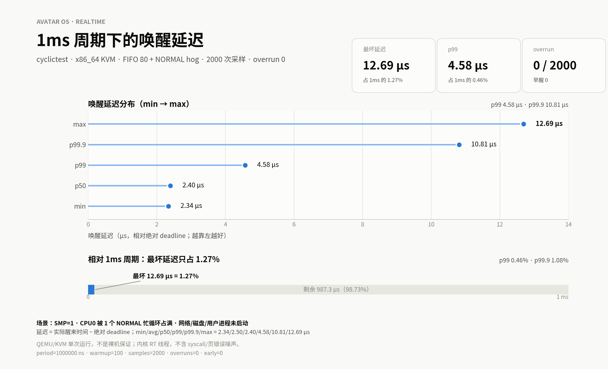

# cyclictest：绝对 deadline 唤醒延迟

> 2026-11-12。属于 `RT_TEST=1`，由 `make -C tests rt-test` 执行。

## 1. 它测什么

rt-tests 的 `cyclictest` 测的是同一个量：

> 一个按**绝对 deadline** 周期睡眠的实时线程，实际醒来时间比 deadline
> 晚了多少？

本项目的版本是**内核态**等价物（用户态 RT API 尚未实现，见
`docs/realtime/ARCHITECTURE.md` 的非目标）：

- 一个 **SCHED_FIFO 80** 的内核 RT 线程，钉在 **CPU0**；
- 周期用 `hrtimer_sleep_until(next)`，`next` 是绝对时间；
- x86_64 有 TSC-deadline oneshot 时周期 **1ms**；aarch64/riscv64 目前
  回退到 **100Hz tick**，周期 10ms；
- 先跑 100 轮 warmup 丢弃，再记录 **2000 轮**；
- 同时跑一个 **NORMAL hog** 钉 CPU0，填满 RT 线程睡眠的窗口，
  让“RT 醒来时抢占一个正在跑普通任务的 CPU”成为常态；
- 醒来后 `latency = now - deadline`；如果已经错过下一个 deadline，
  记一次 `overrun` 并把 `next` 重同步到 `now + period`，不补跑；
- 统计 `min/avg/p50/p99/p99.9/max`、`overruns`、`early`（早醒次数）。

输出（`tests/suites/rt_test.py` 解析）：

```text
=== CYCLICTEST: PASS period=1000000 warmup=100 cycles=2000 samples=2000 \
    min=2323 avg=2971 p50=2425 p99=11752 p999=24214 max=152537 \
    overruns=0 early=0 hog=1 hog_iters=... ===
```

单位都是纳秒。`hog_iters` 是 NORMAL 忙循环实际完成的迭代数；`hog=1`
只说明线程创建成功，`hog_iters>0` 才证明它真的获得了 CPU 时间。

## 2. 怎么跑

推荐走测试框架（自动构建 `rt-test` 变体、自动解析和判阈值）：

```bash
make -C tests rt-test ARCHES=x86_64
# 三架构：
make -C tests rt-test
```

手工启动（串口日志里看 `=== CYCLICTEST ...`）：

```bash
make PLATFORM=qemu-virt-x86_64 RT_TEST=1 LOG=info run
# 有 rootfs 也可以：
make PLATFORM=qemu-virt-x86_64 RT_TEST=1 LOG=info run-fs
```

它和 `RT_SCHED/RT_WORKER/RT_MUTEX/RT_EVENT` 自测一起运行；`RT SCHED TEST:
PASS` 会在 cyclictest 完成后打印。

## 3. 实测样例（x86_64 KVM，SMP=1）

2026-11-12，QEMU `q35 -enable-kvm -cpu host`，`LOG=info`，多次运行：

```text
period=1000000ns warmup=100 cycles=2000 samples=2000
run A: min/avg/p50/p99/p999/max = 2323/2971/2425/11752/24214/152537 ns
run B: min/avg/p50/p99/p999/max = 2322/3291/2707/8587/46264/82876 ns
run C: min/avg/p50/p99/p999/max = 2290/2810/2593/6433/17944/19796 ns
overruns=0 early=0 hog=1
```

- p50 ~2.4–2.7µs，p99 ~4.4–11.8µs，max ~18–153µs；
- 这是 QEMU/KVM 的单次结果，不是裸机保证；max 对宿主调度抖动敏感，
  两次 max 差一倍属于正常波动；
- aarch64/riscv64 是 TCG，绝对延迟被放大，只适合同架构前后对比；
- 没有 oneshot 的架构周期是 10ms（tick 回退），不要把它的绝对值和
  x86 的 1ms 结果直接比较。

同一次 `make -C tests rt-test` 的 TCG 结果（仅说明测试路径通，不是性能）：

```text
aarch64: period=10000000ns avg=5023241 p99=10038208 p999=12953152
         max=13800064ns overruns=28
riscv64: period=10000000ns avg=3601467 p99=3916800  p999=5196600
         max=10350700ns overruns=1
```

TCG 下 aarch64/riscv 的 avg/p99 落在 10ms tick 量级、overrun 不为 0，
是“没有 oneshot hrtimer”的预期结果；接上 oneshot 后应回到 µs 级。
门禁对非 KVM 架构只校验样本数/负载标记，不卡绝对阈值。

### 3.1 可视化（一次具体运行）

以下数据来自一次 x86_64 KVM 运行：

```text
period=1000000 warmup=100 cycles=2000 samples=2000
min=2338 avg=2503 p50=2397 p99=4575 p999=10814 max=12689
overruns=0 early=0 hog=1
```



深色版：[cyclictest_1ms_dark.png](cyclictest_1ms_dark.png)。

| 指标 | 延迟 | 占 1ms 周期 |
| --- | ---: | ---: |
| min | 2.34 µs | 0.23% |
| avg | 2.50 µs | 0.25% |
| p50 | 2.40 µs | 0.24% |
| p99 | 4.58 µs | 0.46% |
| p99.9 | 10.81 µs | 1.08% |
| max | 12.69 µs | 1.27% |
| overrun | 0 / 2000 | — |
| early | 0 | — |

**怎么读：**

- 99% 的唤醒在 deadline 后 **4.58 µs** 内完成；99.9% 在 **10.81 µs** 内；
  最坏一次 **12.69 µs**；
- 12.69 µs 只占 1ms 周期的 **1.27%**；距离漏掉一个周期还有约 **987 µs**
  余量；
- `overruns=0` 表示 2000 个周期里没有一次醒来晚于下一个 deadline；
  `early=0` 表示没有提前醒；
- 分布很紧：p50 2.40 µs，max 12.69 µs，max 约为 p50 的 5.3 倍。这个尾部
  更像宿主 KVM 调度抖动/单次 cache 干扰，而不是调度器路径的系统性成本；
- 本次同时跑了 NORMAL hog，所以这段延迟包含了“RT 线程抢占一个正在忙
  循环的普通任务”的成本。

**边界：** 这是 QEMU/KVM、内核 RT 线程、2000 个样本的结果，不是裸机
保证，也不是硬实时认证；用户态 syscall/页错误/IRQ 风暴下的延迟要另外测。

加入 `hog_iters` 后的一次同场景 x86_64 KVM 运行：

```text
min/avg/p50/p99/p999/max = 2344/2690/2419/7325/17830/19315 ns
overruns=0 early=0 hog=1 hog_iters=6467515359
```

约 2.1 秒内 hog 完成了 **64.7 亿次**忙循环迭代，证明它确实在 RT 线程
睡眠的窗口里持续运行；三架构的 `make -C tests rt-test` 都会断言
`hog_iters > 0`。

生成这张图：

```bash
python3 tools/plot_cyclictest.py \
  --period-ns 1000000 --warmup 100 --samples 2000 \
  --min-ns 2338 --avg-ns 2503 --p50-ns 2397 \
  --p99-ns 4575 --p999-ns 10814 --max-ns 12689 \
  --overruns 0 --early 0 \
  --out docs/realtime/cyclictest_1ms.png

# 深色版加 --dark，换 --out：
python3 tools/plot_cyclictest.py ... --dark \
  --out docs/realtime/cyclictest_1ms_dark.png
```

## 4. 判据

`tests/suites/rt_test.py` 里：

- `warmup == 100`、`cycles == 2000`、`samples == 2000`；
- x86_64 + KVM：`period == 1ms`、`p99 < 1ms`、`max < 5ms`。
  这是**回归门禁**（防止 hrtimer/调度路径退化），不是“软实时验收线”。
  真正的验收线应来自目标硬件上的控制环预算（见
  `docs/reports/ROBOTICS_RT_BASE.md`）；
- 其它架构只校验样本数/负载标记，打印延迟；TCG 不适合卡绝对阈值。

## 5. 与 rt-tests cyclictest 的差异

| 项 | rt-tests | 本测试 |
| --- | --- | --- |
| 线程 | 用户态 pthread | 内核 RT 线程 |
| 优先级 | `sched_setscheduler` | 内核 `task_create_kernel_rt` |
| 睡眠 | `clock_nanosleep(CLOCK_MONOTONIC, TIMER_ABSTIME)` | `hrtimer_sleep_until()` |
| 内存 | `mlockall` 后无页错误 | 无用户 mm，无页错误 |
| 负载 | 可配多种 load | 一个 NORMAL CPU hog |
| 用途 | 用户态端到端延迟 | 内核调度/hrtimer 回归 |

等 `sched_setscheduler` / `mlockall` / `clock_nanosleep` 落地后，应再加
一个用户态 `/bin/cyclictest`；这个内核版本保留为“去掉了 syscall/页错误
噪声”的下界基线。

## 6. 后续增强

1. aarch64/riscv64 接 oneshot hrtimer 后，周期降到 1ms 甚至 100µs；
2. 增加网络/磁盘/NPU 并行 load，观察 IRQ/缓存干扰；
3. 用 GPIO 翻转 + 示波器测“中断→RT 任务→执行器”的端到端延迟；
4. 在实机（RK3588）上跑 1h/72h，记录 p99/max 漂移；
5. 用户态 cyclictest 与 `mlockall`/PI futex 一起加入，形成完整的
   “用户 RT 应用”门禁。

## 7. 代码位置

- `tests/unit-test/cyclictest.c` —— 测试本体；
- `tests/unit-test/rt_sched_test.c` —— 在 `RT_TEST=1` 的末尾调用；
- `tests/suites/rt_test.py` —— 解析、打印、按架构判阈值；
- `include/hrtimer.h` / `kernel/time/hrtimer.c` —— oneshot/回退睡眠；
- `docs/realtime/RT_DEMO_RESULTS.md`、`R0_BASELINE.md` —— 相关调度/IRQ
  延迟基线。
